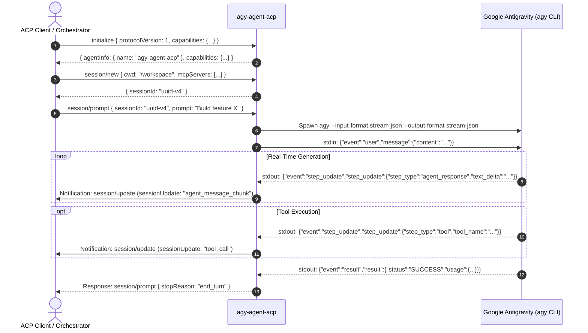

<div align="center">

# ⚡ agy-agent-acp

**Agent Client Protocol (ACP) Adapter for Google Antigravity CLI (`agy`)**

[](https://www.npmjs.com/package/agy-agent-acp)
[](https://opensource.org/licenses/MIT)
[](https://nodejs.org)
[](https://www.typescriptlang.org/)
[-purple?style=flat-square)](https://agentclientprotocol.org)

<p align="center">
  Bridge Google Antigravity CLI's native reasoning engine with any headless agent orchestration harness over standard Agent Client Protocol (ACP).
</p>

</div>

---

## 🌟 Overview

**`agy-agent-acp`** is an [Agent Client Protocol (ACP)](https://agentclientprotocol.org) adapter for **Google Antigravity CLI (`agy`)**.

It bridges headless orchestrators (relays, bots, multi-agent frameworks) with `agy` over `stdio` JSON-RPC, streaming reasoning deltas, tool calls, and token usage in real time.

---

## 🏗 System Architecture

```
┌────────────────────────────────────────────────────────────────────────────────────────┐
│                              AGENT ORCHESTRATOR / HARNESS                               │
│              (e.g., Solace Buzz `buzz-acp`, custom ACP clients, MCP hubs)              │
└───────────────────────────────────────────┬────────────────────────────────────────────┘
                                            │ Standard Input / Output (stdio)
                                            │ Protocol: ACP (JSON-RPC 2.0)
                                            ▼
┌────────────────────────────────────────────────────────────────────────────────────────┐
│                                   agy-agent-acp                                        │
│  ┌──────────────────────────────────────────────────────────────────────────────────┐  │
│  │ 1. ACP Protocol Router (`src/agy-agent.ts`)                                      │  │
│  │    • Handles: initialize, session/new, session/prompt, session/cancel, etc.      │  │
│  │    • Translates internal stream events -> `sessionUpdate` ACP notifications      │  │
│  └────────────────────────────────────────┬─────────────────────────────────────────┘  │
│                                           │                                            │
│  ┌────────────────────────────────────────┴─────────────────────────────────────────┐  │
│  │ 2. Process Manager (`src/agy-process.ts`)                                        │  │
│  │    • Spawns & supervises: `agy --input-format stream-json --output-format ...`   │  │
│  │    • Line-buffered parser for `init`, `step_update`, `tool`, and `result`        │  │
│  │    • Graceful process tree lifecycle & cancellation handling                     │  │
│  └────────────────────────────────────────┬─────────────────────────────────────────┘  │
└───────────────────────────────────────────┼────────────────────────────────────────────┘
                                            │ stdin / stdout (stream-json line protocol)
                                            ▼
┌────────────────────────────────────────────────────────────────────────────────────────┐
│                            GOOGLE ANTIGRAVITY CLI (`agy`)                              │
│                   DeepMind Agentic Reasoning & Tool Execution Engine                   │
└────────────────────────────────────────────────────────────────────────────────────────┘
```

---

## ✨ Features

- ⚡ **Zero-Latency Streaming**: Transforms `agent_response` text deltas into real-time ACP `agent_message_chunk` updates as tokens are generated.
- 🛠 **Tool Execution Telemetry**: Captures tool calls, inputs, and outputs from `agy` and emits structured ACP `tool_call` updates.
- 🔄 **Full ACP Lifecycle Support**: Complete implementation of `initialize`, `session/new`, `session/prompt`, `session/cancel`, and `session/close`.
- 🧠 **Context & Prompt Injection**: Automatically mounts custom system prompt files (e.g. `system-prompt.md`) and preserves workspace directories (`cwd`).
- 📊 **Token Usage Metrics**: Tracks prompt, completion, and total tokens across conversational turns.
- 🛡 **Resilient Process Supervision**: Robust JSON line buffering, error recovery, signal escalation (`SIGTERM` $\rightarrow$ `SIGKILL`), and crash isolation.
- 🚨 **Failed Runs Fail the Turn**: When `agy` cannot run a turn (an `ERROR` result such as a 401 or 503 from the model API, or an `agy` that exits before answering), the prompt fails with a JSON-RPC error (`-32000`, message `agy: <agy's reason>`) instead of ending as if `agy` had answered, so the ACP client can retry it or tell the user.
- 🔑 **Sign-in Retry**: `agy` gives its silent sign-in a fixed 10 seconds (no flag or setting changes it). When the stored access token has expired and the token refresh is slower than that, `agy` fails with `authentication failed or timed out` although the login is fine. If that happens before `agy` reported anything for the turn, the adapter runs the same prompt again on a fresh `agy` (twice by default, after 2 s and 4 s), sending the system prompt again.
- 📈 **Run Metrics (OTLP)**: With `OTEL_EXPORTER_OTLP_METRICS_ENDPOINT` set, every `agy` run is counted by how it ended — `ok`, `cancelled`, or `error` with a fixed class (`capacity`, `quota`, `unavailable`, `auth`, `timeout`, `network`, …) and its HTTP status — with its duration and tokens, pushed as OpenTelemetry metrics. See [Run metrics](#-run-metrics).
- 🌐 **Docker & Multi-Arch Ready**: Built to operate seamlessly across Linux (x86_64 / arm64) and macOS environments.

---

## 🔁 Sequence Flow



---

## 🚀 Quick Start

### 1. Prerequisites

- **Node.js**: `v20.0.0` or higher
- **Google Antigravity CLI**: `agy` installed and authenticated on your machine (`agy auth login`)

### 2. Global Installation

Install globally via npm:

```bash
npm install -g agy-agent-acp
```

Or run directly using `npx`:

```bash
npx agy-agent-acp
```

### 3. Build From Source

```bash
# Clone repository
git clone https://github.com/dongitran/agy-agent-acp.git
cd agy-agent-acp

# Install dependencies
npm install

# Compile TypeScript
npm run build

# Package and link locally
npm link
```

---

## ⚙️ Configuration

`agy-agent-acp` can be customized via environment variables:

| Variable | Description | Default |
| :--- | :--- | :--- |
| `BUZZ_ACP_SYSTEM_PROMPT_FILE` | Optional path to a system instructions file, sent before the first prompt of each `agy` process (merged with a system prompt the client passes in `session/new`) | unset |
| `AGY_AGENT_LOGS` (or `BUZZ_ACP_LOG_DIR`) | Directory for `agy-acp.log`; logs always go to `stderr` as well | unset |
| `AGY_ACP_SIGNIN_RETRIES` | How many times a turn whose `agy` could not finish its sign-in is run again on a fresh `agy` (0 turns it off; at most 5) | `2` |
| `AGY_ACP_SIGNIN_RETRY_DELAY_MS` | Wait before the first such retry, doubled for each further one (at most 30000) | `2000` |
| `AGY_ACP_EXIT_AFTER_TURN` | `1`: end the `agy` process after each turn and start a fresh one for the next prompt (an idle `agy` holds 75-100 MB; useful when the client keeps many sessions open) | unset |

`agy` itself is spawned as `agy` from `$PATH`, with the adapter's environment.

---

## 📈 Run metrics

Off unless `OTEL_EXPORTER_OTLP_METRICS_ENDPOINT` is set; the OpenTelemetry metrics SDK is not even loaded then. When on,
the adapter pushes OTLP/HTTP (protobuf, cumulative temporality) every `OTEL_METRIC_EXPORT_INTERVAL` ms and right after
each run, and never lets an export fail, delay or change a turn. The resource is empty, so a receiver such as
VictoriaMetrics (`/opentelemetry/v1/metrics`) stores only the labels below.

| Series | Labels | What it counts |
| :--- | :--- | :--- |
| `agy_runs_total` | `outcome`, `error_class`, `http_code` + common | One per `agy` run (a sign-in retry is a run of its own) |
| `agy_run_duration_seconds` (histogram) | `outcome` + common | Wall-clock time of a run; buckets 1 s … 2 h |
| `agy_tokens_total` | `type` (`input`, `output`, `cache_read`, `thinking`) + common | The run's last usage report |

Common labels: `agent` (`AGENT_ID`), `community` (`AGENT_COMMUNITY`), `model` (`AGY_MODEL`), `account` (`AGY_ACCOUNT`, a
number naming the `agy` login — never the token or its e-mail). An empty label is left out.

`error_class` reduces `agy`'s message to a fixed set (the message itself is never exported):

| `error_class` | `agy` said, for example |
| :--- | :--- |
| `capacity` | `UNAVAILABLE (code 503): No capacity available for model … on the server` |
| `quota` | `Individual quota reached … Resets in 5h44m` (`http_code` 429), `RESOURCE_EXHAUSTED` |
| `unavailable` | any other 503 |
| `auth` | `authentication failed or timed out`, 401, 403 |
| `invalid_request` | `INVALID_ARGUMENT (code 400)` |
| `server_error` | another 5xx |
| `malformed_output` | `improperly formatted function call` |
| `timeout` | `stream idle timeout`, `deadline exceeded` |
| `network` | `dial tcp …`, `There was a network issue`, `The stream was interrupted` |
| `exited` | `agy` exited before it answered |
| `other` | anything else |

A run that `agy` retried internally (`Run: attempt N failed … retrying`) and then finished counts once, by how it ended.

| Variable | Description | Default |
| :--- | :--- | :--- |
| `OTEL_EXPORTER_OTLP_METRICS_ENDPOINT` | Full OTLP/HTTP metrics URL, e.g. `http://vmagent:8429/opentelemetry/v1/metrics` | unset (off) |
| `OTEL_METRIC_EXPORT_INTERVAL` | Periodic export interval, ms | `15000` |
| `OTEL_METRIC_EXPORT_TIMEOUT` / `OTEL_EXPORTER_OTLP_METRICS_TIMEOUT` | Export timeout, ms | `5000` |
| `AGENT_ID`, `AGENT_COMMUNITY`, `AGY_MODEL`, `AGY_ACCOUNT` | The common labels | empty |

> 0.1.x is the maintenance line of 0.1.4: 0.1.6 is 0.1.4 with run metrics only (no Phoenix tracing, which 0.1.5 and 0.2.x carry).

---

## 🐳 Docker Deployment

To containerize `agy-agent-acp` inside headless production environments (such as Kubernetes or Docker Compose):

```dockerfile
FROM node:22-slim

# Install system dependencies
RUN apt-get update -qq && apt-get install -y -qq ca-certificates git bash curl \
    && rm -rf /var/lib/apt/lists/*

# Install agy-agent-acp
RUN npm install -g agy-agent-acp

# Set non-root user
USER node
WORKDIR /workspace

ENTRYPOINT ["agy-agent-acp"]
```

> [!TIP]
> Mount your host's authenticated `~/.gemini` folder and `agy` binary for zero-configuration authentication:
> ```yaml
> volumes:
>   - ~/.local/bin/agy:/usr/local/bin/agy:ro
>   - ~/.gemini:/home/node/.gemini:rw
> ```

---

## 🧪 ACP Protocol Methods

| ACP Method | Wire Type | Description |
| :--- | :--- | :--- |
| `initialize` | Request / Response | Negotiates client & agent capabilities and protocol versions. |
| `session/new` | Request / Response | Allocates a new conversation session and validates workspace directory. |
| `session/prompt` | Request / Response | Dispatches user instruction into `agy` and triggers turn execution. |
| `session/update` | Notification | Streams `agent_message_chunk`, `tool_call`, and `usage_update` events. |
| `session/cancel` | Request / Response | Interrupts running generation turns via process signals. |
| `session/close` | Request / Response | Cleans up session resources and terminates background processes. |

---

## 📄 License

Distributed under the **MIT License**. See [`LICENSE`](./LICENSE) for more information.

---

<div align="center">
  <sub>Built with ❤️ by <a href="https://github.com/dongitran">@dongitran</a> for the Decentralized Agentic AI Ecosystem.</sub>
</div>

